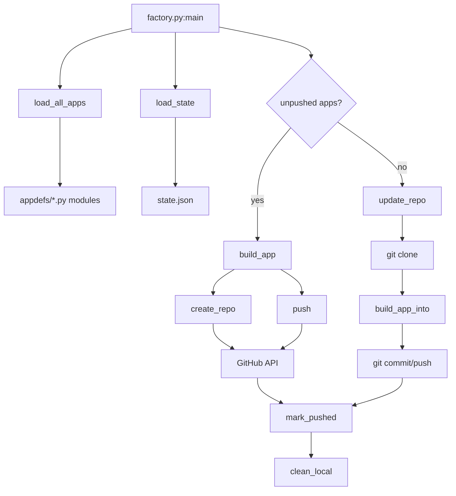

# ai-factory — Alan Vo | AI & Machine Learning

> Work in progress. This checkpoint may be incomplete or fail tests. See PLAN.md and STATUS.md before use.

ai-factory builds complete project trees from a checked-in catalog of application templates and can publish those trees to GitHub. The generator is deterministic Python: each template supplies a description, feature list, and source, and the factory writes the repository layout around them. It is for a developer who wants a starting repository from that catalog.

The supported interface in this checkpoint is the `ai-factory` command. Files under `backend/` and `frontend/` are an unfinished browser console.

<div align="center">


</div>

## Overview

**ai-factory** is a Python CLI tool that generates complete AI/ML application repositories from a catalog of 31+ app definitions and publishes them to GitHub. It operates in a 1-for-1 rotation: create new repositories until the catalog is exhausted, then update the oldest repository with enhancements.

Built by [Alan Vo](https://github.com/ALANDVO) — AI/ML & cybersecurity engineer.

## AI/ML evaluation

This repository does not train a model. The reproducible check lists the catalog:

```bash
ai-factory --list
```

On 2026-10-14 that command printed `Available apps (31)`. The number is how many template definitions the appdefs modules loaded in this checkout. Generated apps may call an operator-configured language model when those apps are run later. Factory tests mock GitHub HTTP and do not call a model provider. If an appdefs module fails to import, its templates are omitted and the printed count is lower.

## Features

- **31+ App Templates** across security, cloud, enterprise, data, and ML domains
- **Automated GitHub Publishing** — creates repos, pushes code, tracks state
- **Update Cycle** — rotates through existing repos, enhancing each in turn
- **Local Cleanup** — removes local build artifacts after push
- **Extensible Architecture** — add new app definitions without modifying core logic
- **Comprehensive Test Suite** — 29 unit tests covering state management, API calls, file generation, and build orchestration

## App Catalog

Categories include:
- **Security**: Threat intelligence analyzer, log anomaly detector, vulnerability prioritizer, compliance checker
- **Cloud**: Cost optimizer, infrastructure scanner, deployment validator, multi-cloud orchestrator
- **Enterprise**: Data catalog, API gateway, feature flag manager, secrets rotator
- **Data/ML**: Model registry, experiment tracker, data quality monitor, drift detector
- **Generative AI**: Prompt optimizer, RAG evaluator, agent benchmark, fine-tuning pipeline

## Quick Start

```bash
# Clone the factory
git clone https://github.com/ALANDVO/ai-factory-alan-vo.git
cd ai-factory-alan-vo

# Create virtual environment and install
python3 -m venv .venv
source .venv/bin/activate
pip install -e .

# Configure GitHub token (required). Use your own token locally. Leave it out of git.
export GITHUB_TOKEN=""

# List available apps
ai-factory --list

# Run factory (creates next unpushed app, or updates oldest)
ai-factory
```

## Usage

### List all available apps
```bash
ai-factory --list
```

### Build a specific app (dry-run, no push)
```bash
ai-factory --app threat-intel-analyzer --dry-run
```

### Run update cycle only
```bash
ai-factory --update-only
```

### Full run (create or update)
```bash
ai-factory
```

## Architecture



### Core Modules

| Module | Responsibility |
|--------|----------------|
| `factory.py` | Main orchestration: build, push, update, state management |
| `apps.py` | Shared file generation helpers (README, Dockerfile, etc.) |
| `appdefs.py` + `appdefs_*.py` | App definitions (name, description, features, code templates) |
| `gen.py` | Legacy entry point (kept for compatibility) |

### State Management

- `state.json` — tracks pushed repos, timestamps, update counts
- `pushed.log` — timestamped operation log
- Local repo directories cleaned after successful push

## Configuration

### Required Environment Variables

| Variable | Description |
|----------|-------------|
| `GITHUB_TOKEN` | GitHub personal access token with `repo` scope |

### Optional Environment Variables

| Variable | Default | Description |
|----------|---------|-------------|
| `GH_USER` | `ALANDVO` | GitHub username/organization |
| `EMAIL` | `alanvo@gmail.com` | Commit author email |
| `BASE` | `~/ai-factory/repos` | Local build directory |
| `LOG` | `~/ai-factory/pushed.log` | Log file path |
| `STATE` | `~/ai-factory/state.json` | State file path |

## Development

### Run tests
```bash
pytest tests/ -v
```

### Lint
```bash
ruff check .
```

### Add a new app
1. Create a new `appdefs_*.py` file or add to existing
2. Define app using the `app()` function with all required fields
3. Run `ai-factory --list` to verify it's picked up

## Generated App Structure

Each generated app includes:
- `README.md` — project documentation with badges, usage, tech stack
- `LICENSE` — MIT license
- `requirements.txt` — Python dependencies
- `Dockerfile` — multi-stage build with non-root user
- `docker-compose.yml` — app service with healthcheck
- `CONTRIBUTING.md` — contribution guidelines
- `.github/CODEOWNERS` — code ownership
- App-specific source code (varies by template)

## License

MIT License — see [LICENSE](LICENSE)

Copyright (c) 2026 Alan Vo <alanvo@gmail.com>

---

**Built by [Alan Vo](https://github.com/ALANDVO)** | AI, ML & Cybersecurity